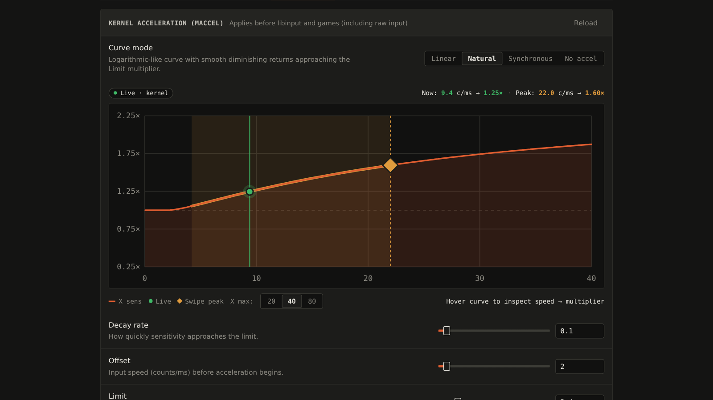
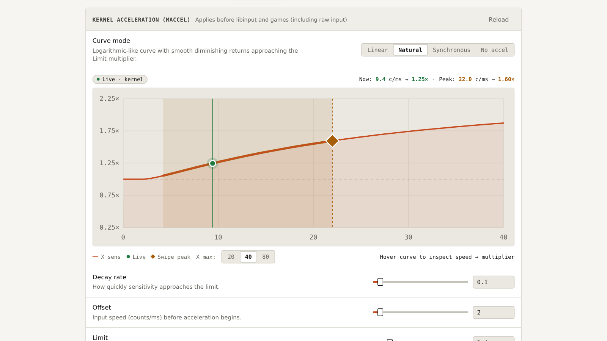
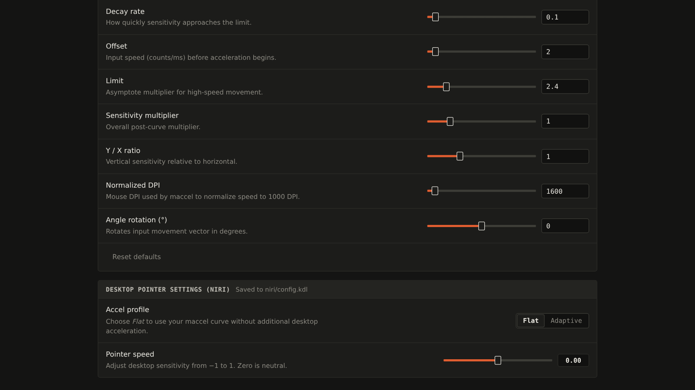
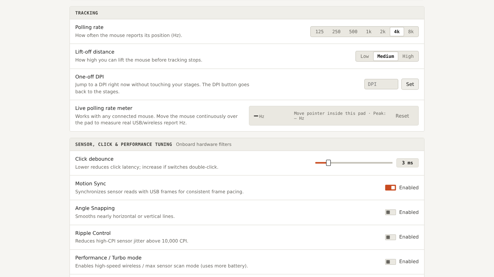

# Mouse Tool

A lightweight, universal web and CLI suite for managing **multiple connected mice at once**, kernel-level mouse acceleration (through the kernel accel module), and desktop pointer settings on Linux — without vendor bloatware.

## Screenshots

These images come from a synthetic fixture, not from a real device or session: a made-up Pulsar Pro (fake serial) in the browser and a stubbed local helper. Regenerate them with `python3 docs/capture_screenshots.py`, using the browser and font versions recorded in the [capture script](docs/capture_screenshots.py). Select an image to open it at full resolution.

[](docs/screenshots/sensitivity-dark.png)

*Sensitivity, dark theme: the fleet bar, live status tiles, DPI stages, polling rate and lift-off distance. A second, detected-only mouse sits beside the connected one.*

[](docs/screenshots/sensitivity-light.png)

*The same view in the light theme. The UI follows the system colour scheme.*

[](docs/screenshots/acceleration-dark.png)

*Acceleration, dark theme: the curve editor with the live speed marker, the swipe-peak marker and the Now and Peak readouts.*

[](docs/screenshots/acceleration-light.png)

*The same view in the light theme.*

[](docs/screenshots/desktop-pointer-dark.png)

*Curve parameters and the **Desktop pointer settings** group (niri in this capture), with the Flat profile selected.*

[](docs/screenshots/tuning-light.png)

*Sensitivity, scrolled: tracking options and the sensor, click and performance tuning controls. Which controls appear depends on the connected mouse.*

## Supported Protocols & Hardware

- **Razer (`VID 1532`)** — 90-byte HID feature report protocol (DPI stages, split X/Y, polling up to 8 kHz via HyperPolling dongle, preset & asymmetric LOD, Normal + HyperShift button remaps, power/sleep, wireless battery, pairing).
- **Endgame Gear 8k (`VID 3367`)** — Full read-modify-write NVRAM & real-time event protocol (`OP1 8k`, `XM2 8k`, `OP1 8k Purple Frost`, `OP1 8k v2`, `XM2 8k v2`): CPI stages (`10`/`50` DPI steps), polling (`1000–8000 Hz`), normal LOD (v1 including Purple Frost: 0.7, 1 or 2 mm; v2: 0.7–1.7 mm in 0.1 mm steps), glass LOD (1 or 2 mm on Purple Frost and v2), Motion Sync, Angle Snapping, Ripple Control, Slamclick Filter, Motion Jitter Filter, Angle Tuning (`v2`), Force Max Sensor FPS (`v2`), Disable LED on Lift-Off (`v2`), GX Speed/Safe SPDT & multiclick filter, left-handed button swap, and factory reset.
- **Endgame Gear `-we` (`VID 3367`)** — CompX Feature `0x08` + Input `0x09` protocol (`OP1we`, `XM2we` wired & wireless, with automatic `0xA1` exclusion so `OP1w 4K v2` is never misclassified): DPI stages, polling (`125–1000 Hz`), LOD, debounce, Motion Sync, Angle Snapping, Ripple Control, sleep timeout, and battery.
- **Logitech HID++ 2.0 (`VID 046D`)** — Multi-device support for Superlight / G Pro / G502 / MX Series (DPI, polling rate, firmware, serial, and unified/sysfs battery reporting).
- **Pulsar (`VID 3710`, `25A7`, `3554`)** — Supported protocol families and their controls are listed below. The PID table identifies known devices.
  - **Pulsar XS-1 (`3710`)** (`X2A v3`, `X3 M`, `XS-1`, `8K Dongle`): DPI, read-only polling readout, LOD, debounce, Motion Sync, Angle Snapping, Ripple Control, firmware, and wireless battery.
  - **Pulsar Pro (`3710:5405`)**: Full multi-stage DPI, `125–8000 Hz` polling, LOD, debounce, Motion Sync, Ripple Control, Angle Snapping, Angle Tuning, Turbo mode, sleep timeout, and battery.
  - **Pulsar Areson (`25A7:FA7B/FA7C`)** (`X2 v2 / X2H / Xlite v3`) & **Pulsar 4K Receiver (`3554:F507–F509`)** & **Pulsar CompX (`3710`)**: 3-tier `10/50/100` DPI encoding, stages, polling (`125–4000/8000 Hz`), LOD, debounce, filters, and battery.
- **CompX Report `0x08` ODM Ecosystem (`VID 3554`, `373B`)** — Protocol-verified support for **ATK / VXE** (with dynamic `0x10` product probing across `F1 Ultimate 2.0`, `A9 Mini+`, `A9 Plus NearLink`, `VXE R1 / Pro Max / SE+`, `X1 Pro Max`), **Scyrox** (`V8`, `V8S`, `V8S Turbo`, including 6-byte DPI up to 50,000, 5-stop LOD, and 20K Scan Mode), **Teevolution Terra Pro**, **VGN F2 Master+**, and **Lamzu Atlantis** (1K & 4K).
- **Glorious (`VID 258A`, `22D4`, `320F`, `3794`, `093A`)** —
  - **Sinowealth** (`Model O/O-`, `Model D/D-`, `Model O Eternal`): 123B+ flash config readout & sensor-gated stage/polling writes (safe sensor ID check in WebHID).
  - **CORE 2 (`Model O 2 Pro / D 2 Pro 4K/8K`)**: Firmware/battery queries plus write-only DPI stages, `125–8000 Hz` polling, debounce, Motion Sync, backed by persistent local state cache (`~/.cache/mousetool/device_state.json` & `localStorage`).
  - **Classic (`Model O/D/I/O2/D2/I2 Wireless/Wired`, `Series One Pro`, `Forge`, `3794` CORE 2 Classic)**: Descriptor-length (`64B`) and generation (`core2` vs `legacy`) safety-gated writes + wireless battery queries.
  - **Pixart (`093A`)** (`Model O 2 Mini`, `Series 2 Pro`, `Model D 2 Mini`, `Model O 3`, `Model D 3`): `64B` Feature `0x03` config packet for DPI, polling, LOD, and debounce with local cache persistence.
- **Generic USB and Bluetooth mice** — **Any HID…** can connect interfaces the browser exposes through WebHID. The raw input snooper can read reports from eligible collections. Browsers protect standard mouse collections. The local helper can still list system-detected mice in the fleet bar via `/sys/class/input/mouse*`. The generic controls include pointer-event polling, a button/scroll tester and a local DPI reference.

| Vendor | Supported PIDs |
| --- | --- |
| **Razer** (`1532`) | Viper V2 Pro (`00a5`, `00a6`), DeathAdder V3 / V3 Pro (`00b2`, `00b6`, `00b7`, `00c2`, `00c3`), DeathAdder V3 HyperSpeed (`00c4`, `00c5`), Viper V3 Pro / HyperSpeed (`00c0`, `00c1`, `00b8`), Cobra Pro (`00af`, `00b0`), Basilisk V3 Pro / 35K (`00aa`, `00ab`, `00cc`, `00cd`, `00d6`, `00d7`), HyperPolling Dongle (`00b3`) |
| **Endgame Gear** (`3367`) | **8k:** OP1 8k (`1964`), XM2 8k (`1966`), OP1 8k Purple Frost (`1976`), OP1 8k v2 (`1978`), XM2 8k v2 (`1980`) · **`-we`:** XM2we (`1960`, `1968`, `1982`), OP1we (`1961`, `1962`, `1970`, `1972`) |
| **Logitech HID++** (`046D`) | G Pro / Superlight / Superlight 2 (`c088`, `c092`, `c094`, `c099`), G305 (`c095`), G502 Hero / Lightspeed / X (`c08b`, `c093`, `c09d`, `c09e`), MX Master 3/3S (`b023`, `b034`), Unifying / Lightspeed / Bolt (`c52b`, `c539`, `c53f`, `c547`, `c548`, `c54d`) |
| **Pulsar** (`3710`, `25A7`, `3554`) | **XS-1 (`3710`):** `3404`, `3409`, `3410`, `5402`, `5403` · **Pro (`3710`):** `5405` · **Areson (`25A7`):** `fa7b`, `fa7c` · **4K Receiver (`3554`):** `f507`, `f508`, `f509` (plus CompX fallback on `3710`) |
| **CompX ODM** (`3554`, `373B`) | **Scyrox:** `f515`, `f517`, `f5f7` · **Teevolution:** `f520`, `f522`, `f523`, `f5bb` · **VGN F2:** `fb56`, `fb57` · **Lamzu Atlantis:** `f50d`, `f50f`, `f510` · **ATK / VXE (`3554`/`373B`):** `f58a`, `f58c`, `f58e`, `f58f`, `1085`, `10c9`, `11d9` |
| **Glorious** (`258A`, `22D4`, `320F`, `3794`, `093A`) | **Sinowealth:** `258a:0033`, `258a:0036`, `3794:a000` · **CORE 2:** `258a:201b`, `258a:201c`, `258a:2035`, `258a:2036` · **Classic:** **258A:** `2011`, `2012`, `2013`, `2014`, `2015`, `2018`, `2019`, `201a`, `201d`, `2022`, `2023`, `2024`, `2025`, `2027`, `2031`, `2033`, `2034`, `2039`, `22d4:1503`, `320f:821a/823a/831a`, `3794:a300/a312` · **Pixart (`093A`):** `821b`, `821d`, `822a`, `822b`, `822d`, `824a`, `824b`, `824d`, `825a`, `826a`, `826b`, `826d`, `827a`, `832a` |

## Features

- **Web Interface (`index.html`)**:
  - **Multi-Mouse Fleet Switcher**: Connect and manage multiple simultaneous WebHID mice (**Connect mouse** for supported devices or **Any HID…** for eligible generic interfaces)—even multiple identical VID:PID mice side by side (1-to-1 split-endpoint pairing and instance badges)—while also showing passive system-detected mice from `mousetool.py serve`.
  - **Sensitivity & Sensor**: DPI/CPI stages (optional split X/Y), one-off DPI, polling rate selector (`125–8000 Hz`, or read-only badge where hardware-locked such as Pulsar XS-1), Razer preset/async LOD, EGG discrete/glass LOD, Scyrox 5-stop LOD, or Low/Med/High preset LOD.
  - **01.3 Sensor, click & performance tuning**: Capability-driven controls for Click Debounce (`ms`), Motion Sync, Angle Snapping, Ripple Control, Performance/Turbo mode, 20K Scan Mode (Scyrox V8S), Anti-mistouch (ATK F1 Ultimate 2.0), plus Endgame Gear Slamclick, Motion Jitter, Glass Mode, Lift-Off LED disable, Force Max FPS, Angle Tuning, and GX Speed/Safe SPDT.
  - **Live Polling Rate Meter & Input Tester**: Works with every connected mouse (`pointerrawupdate` / `getCoalescedEvents`) alongside onboard Razer Normal + HyperShift remaps and EGG left-handed swap.
  - **Power & Device Info**: Battery/sleep controls for wireless mice, protocol & HID collection diagnostics, cached write-only state notices where hardware offers no getter, EGG factory reset, and a **raw HID input snooper**.
  - **Acceleration (kernel accel module + desktop pointer settings)**: Interactive SVG curve visualizer and parameter editor for `Linear`, `Natural`, `Synchronous`, and `No accel` modes, with a live speed marker and swipe-peak indicator fed by the helper's `/api/motion` stream (falling back to approximate window-only pointer motion if that stream is unavailable), desktop pointer profile and speed controls for niri, GNOME, Plasma (Wayland), Hyprland and COSMIC (see below), and one-click `Use mouse DPI` synced to the active fleet mouse.
- **CLI & Local API (`mousetool.py`)**:
  - `list [--json]`: Discover all configurable and passive generic mice connected to the system.
  - `status [-d SEL | --all] [--json]`: Full hardware readout across one or all connected mice (supports index `1`/`2`, `VID:PID`, `/dev/hidrawN`, driver name, or substring).
  - `battery [-d SEL | --all] [--json]`: Battery percentage and charging state. Single-device queries can fall back to `~/.cache/mousetool/battery.json` when a mouse is offline or asleep. With `--all`, a failed device read is marked stale.
  - `dpi [-d SEL] [X [Y]]`, `stages [-d SEL] ...`, `poll [-d SEL] [HZ]`, `lod [-d SEL] ...`, `power [-d SEL] ...`, `tune [-d SEL] [--debounce MS ...]`: Configure one mouse per invocation. Use `-d SEL` to choose the target.
  - `maccel [--set K=V ...]`: Inspect or update `maccel` kernel parameters and reboot-persistent reset scripts.
  - `rawaccel {preview|export|import}`: Offline preview/export of the current `maccel` curve as [Raw Accel](https://github.com/RawAccelOfficial/rawaccel) v1.7.1 settings for Windows (see below). Never applies anything.
  - `serve [--port N]`: Local HTTP API (`127.0.0.1:8766`) serving `/api/status` (with `system_mice`), `/api/devices`, `/api/maccel`, `/api/desktop`, and the `/api/motion` live-telemetry event stream. The original `/api/niri` write endpoint remains available.
  - `open`: Launches `index.html` in a WebHID-capable browser (`brave`, `chromium`, or `google-chrome`), falling back to `xdg-open` if none is installed.
- **Diagnostics (`probe.py`)**: Reads device state by default and scans all connected HID mice (`Razer`, `Endgame Gear 8k / -we`, `Logitech HID++`, `Pulsar`, `CompX ODM`, `Glorious`, and generic mice) by protocol. The opt-in `--roundtrip-stages` check writes the current Razer DPI stages back to the mouse and reads them again.

## Setup

### 1. Desktop launcher & background helper service
Run `install.sh` to install `mousetool.desktop` (`~/.local/share/applications/`) and enable the `mousetool.service` systemd user service (`mousetool.py serve` on `127.0.0.1:8766`):
```bash
./install.sh
# Or also install/update udev rules (prompts for sudo):
./install.sh --udev
```

### 2. Udev rules (for WebHID & non-root hidraw access)
If upgrading from an older version, reinstall `60-mousetool.rules` to pick up all newly supported vendor rules:
```bash
sudo cp 60-mousetool.rules /etc/udev/rules.d/
sudo udevadm control --reload-rules && sudo udevadm trigger
```

### 3. `maccel` write permissions (optional, for Acceleration tab)
If using [`maccel`](https://www.maccel.org), add your user to the `maccel` group and log out/in:
```bash
sudo usermod -aG maccel "$USER"
```

## Usage

### Web Interface
Launch from your app menu (**Mouse Tool**), or run:
```bash
./mousetool.py open
```

### Desktop pointer settings

Open **Acceleration → Desktop pointer settings** to change the acceleration profile or pointer speed. Choose **Flat** to avoid stacking desktop acceleration on a maccel curve. The controls work independently of the kernel module. Each desktop accepts speed directly on the **−1 to 1** scale. The slider moves in increments of 0.05. Existing native profiles such as GNOME’s `default` appear by name until you choose Flat or Adaptive.

| Desktop | Where the two settings go | Scope and fixture coverage |
| --- | --- | --- |
| niri | `mouse { accel-profile …; accel-speed …; }` in `$XDG_CONFIG_HOME/niri/config.kdl` | Existing mouse block in the main file. KDL fixtures exercise both profiles, insertion and preservation of adjacent settings. Speed writes retain the existing three-decimal precision. [niri input configuration](https://niri-wm.github.io/niri/Configuration:-Input.html#pointing-devices) |
| GNOME | `gsettings` keys `accel-profile` and `speed` in `org.gnome.desktop.peripherals.mouse` | Persistent mouse preferences. Requires a running GNOME Shell on the helper’s user bus, `busctl`, and both keys writable. Schema and mocked command replies cover default, locked and writable states. [GNOME schema 49.0](https://github.com/GNOME/gsettings-desktop-schemas/blob/49.0/schemas/org.gnome.desktop.peripherals.gschema.xml.in) |
| Plasma Wayland | `busctl` reads KWin input devices and sets `pointerAccelerationProfileFlat` or `pointerAccelerationProfileAdaptive`, and `pointerAcceleration` | KWin applies and saves the selected mouse’s preferences. It stores speed to three decimals. D-Bus fixtures cover capabilities, multiple mice and touchpad exclusion. X11 is unsupported. [KWin Plasma 6.5 properties](https://github.com/KDE/kwin/blob/Plasma/6.5/src/backends/libinput/device.h) · [persistence](https://github.com/KDE/kwin/blob/Plasma/6.5/src/backends/libinput/device.cpp) |
| Hyprland | `hyprctl -j getoption` for `input.accel_profile` and `input.sensitivity`, then `hyprctl eval` with `hl.config`. Older hyprlang sessions use colon-separated names and `hyprctl keyword`. | Global runtime settings expire on reload. Device overrides can take precedence. JSON and command fixtures cover both command dialects. [0.54 variables](https://wiki.hypr.land/0.54.0/configuring/variables/) · [current config options](https://github.com/hyprwm/hyprland-wiki/blob/main/content/configuring/core/config-options.md) · [hyprctl](https://github.com/hyprwm/hyprland-wiki/blob/main/content/configuring/core/advanced-configuration/using-hyprctl.md) |
| COSMIC | `acceleration` record with `profile: Some(Flat/Adaptive)` and `speed` in `$XDG_CONFIG_HOME/cosmic/com.system76.CosmicComp/v1/input_default` | Persistent non-touchpad defaults. Device entries can override them. RON fixtures exercise serialized v1 records and creation from system defaults. Unrecognized acceleration syntax disables editing. [v1 input types](https://github.com/pop-os/cosmic-comp/blob/abb6ebc49ba58daa14163872954cdef3f830a04a/cosmic-comp-config/src/input.rs) · [watch and apply](https://github.com/pop-os/cosmic-comp/blob/abb6ebc49ba58daa14163872954cdef3f830a04a/src/config/mod.rs) |

The helper detects the desktop from its session environment, starting with `XDG_CURRENT_DESKTOP`. If the helper started before login and has no desktop hints, it checks the systemd user manager’s environment on each detection attempt. To select one explicitly, set **`MOUSETOOL_DESKTOP`** to `niri`, `gnome`, `plasma`, `hyprland`, or `cosmic` in the helper’s environment. For example, launch `MOUSETOOL_DESKTOP=plasma ./mousetool.py serve`. With multiple Plasma mice, also set `MOUSETOOL_PLASMA_DEVICE` to the intended current kernel event name, such as `event7`. Event names can change after reconnecting or rebooting. An explicit niri or COSMIC selection edits stored preferences even when that compositor is offline. With no override, an unknown or undetected desktop leaves editing unavailable.

`GET /api/desktop` and the `desktop` field of `GET /api/status` expose the backend, label, writability, profile, speed and status message. Send `POST /api/desktop` with the existing `X-Mouse-Tool: 1` header and a JSON object such as `{"accel_profile":"flat","accel_speed":0.25}`. A successful response includes the settings read back from that backend.

Verification of these five desktop backends used temporary files, mocked command output and upstream documentation. That verification did not include a real desktop session.

### CLI Examples
```bash
# List all connected mice (configurable + generic)
./mousetool.py list

# Full status for all supported connected mice
./mousetool.py status --all

# Target a specific mouse by index, driver, model substring, VID:PID, or hidraw
./mousetool.py status -d op1
./mousetool.py dpi -d viper 1600
./mousetool.py poll -d 3367:1964 4000
./mousetool.py tune -d op1 --motion-sync on --spdt gx_speed
./mousetool.py tune -d pulsar --debounce 2 --motion-sync on

# Battery JSON (for status bars such as Noctalia)
./mousetool.py battery --json

# Inspect or update maccel parameters
./mousetool.py maccel
./mousetool.py maccel --set MODE=natural LIMIT=1.5 DECAY_RATE=0.1
```

### Raw Accel export (Windows, offline)
`rawaccel_export.py` maps the four `maccel` modes and `SENS_MULT`, `YX_RATIO`, `ANGLE_ROTATION` and `INPUT_DPI` to a Raw Accel v1.7.1 `settings.json`, the file Raw Accel's `writer.exe` reads. It is pure Python with no Linux-only imports, so it also runs on Windows as `python rawaccel_export.py ...`. It only writes files you name; it never runs the writer or touches a driver.

| maccel | Raw Accel v1.7.1 |
| --- | --- |
| `linear` (`ACCEL`, `OFFSET`, `OUTPUT_CAP`) | Classic, exponent 2, Gain off, cap mode `output` |
| `natural` (`DECAY_RATE`, `OFFSET`, `LIMIT`) | Natural, Gain on |
| `synchronous` (`GAMMA`, `SMOOTH`, `MOTIVITY`, `SYNC_SPEED`) | Synchronous, Gain off |
| `no_accel` | No Acceleration |
| `SENS_MULT` / `YX_RATIO` / `ANGLE_ROTATION` | Output DPI = `SENS_MULT` × 1000 / Y/X output DPI ratio / Degrees of rotation |
| `INPUT_DPI` | `defaultDeviceConfig` DPI (applies to every mouse without its own device entry) |

Anything that can't be carried exactly is listed under **Lossy** rather than dropped: `ACCEL=0`, the app default, because Raw Accel requires acceleration > 0, and a non-integer DPI. Linear with `ACCEL=0` and natural with `LIMIT=1` are flat curves, so they export as No Acceleration. Per-device settings and timing (polling rate, time clamp) are listed as **Unsupported**. Every `export` prints its lossy and unsupported items and the curve check result on stderr, whether the JSON goes to stdout or `-o`.

The curve check samples about 460 speeds from 1e-6 to 1e6 counts/ms, including points just around each formula's branch points (offset, cap, sync speed and clamp edges). It compares Raw Accel's formula on the exported settings with both the Studio preview curve and maccel 0.5.9's formula, plus a motion pipeline check, at a relative tolerance of 1e-6. Raw Accel and maccel use the same formulas. The Studio preview has two synchronous-only shortcuts: it floors speeds below 1e-6 and returns exactly 1× within 1e-9 counts/ms of `SYNC_SPEED`. With steep settings, or a very small `SYNC_SPEED`, this can put the preview more than 1e-6 away from both. The check then reports **NOT EQUIVALENT** and names the shortcut. Natural mode with a steep `LIMIT` or a tiny `DECAY_RATE` cancels badly at very low speeds. Studio (JavaScript) and Raw Accel (C++) compute the same expression there with different `exp()` implementations, so they can disagree. Where a 2-ulp `exp()` difference would move the result past the tolerance, the check reports **NOT VERIFIED** instead of claiming equivalence. The versioned export embeds the full report; `--settings-only` only prints its result line, and `--no-check` skips it.

```bash
# Show the mapping and curve check for the loaded maccel settings (read-only)
./mousetool.py rawaccel preview --live

# Versioned export (schema_version 1): source parameters, mapping report, curve check, Raw Accel settings
./mousetool.py rawaccel export --live -o mousetool-rawaccel.json

# Only the Raw Accel settings.json, from explicit parameters
./mousetool.py rawaccel export --settings-only --set MODE=natural LIMIT=1.5 DECAY_RATE=0.1 -o settings.json

# Read an export or a Raw Accel settings.json back into maccel parameters (prints JSON; applies nothing)
./mousetool.py rawaccel import settings.json
```

## Tests
```bash
python3 -m unittest -v test_mousetool.py test_desktop_pointer.py test_rawaccel_export.py
```
The suite requires no third-party Python packages. The JavaScript curve comparison skips when Node.js is unavailable. The Plasma command-line parser check skips when `busctl` is unavailable.
