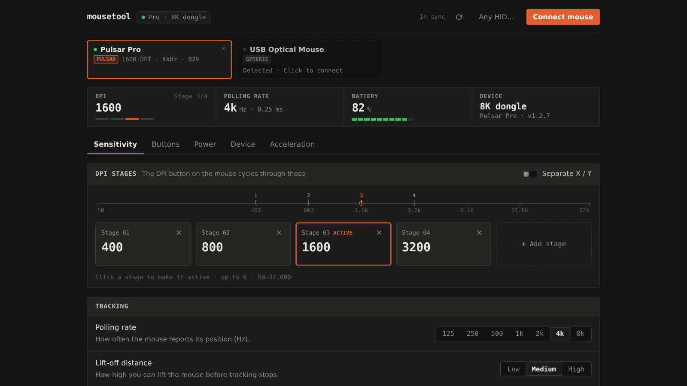
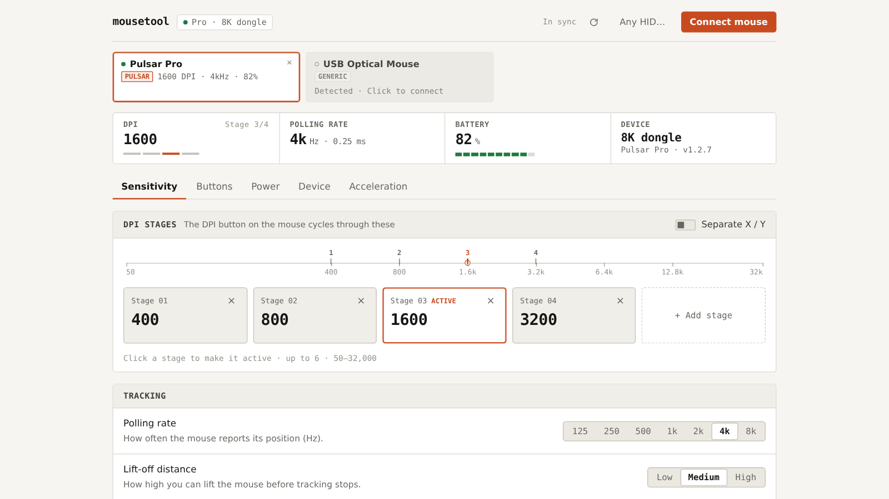

# Mouse Tool

A lightweight, zero-bloat web and CLI suite for managing **multiple gaming and wireless mice at once**, kernel-level mouse acceleration (`mouseaccel` or `maccel` on Linux, Raw Accel on Windows 11), and desktop pointer settings — with no background telemetry or vendor bloatware.

## Screenshots

[](docs/screenshots/sensitivity-dark.png)
*Sensitivity (dark) — multi-mouse fleet switcher, DPI stage track, polling rate, and lift-off distance.*

[](docs/screenshots/sensitivity-light.png)
*Sensitivity (light) — automatic system theme adaptation.*

[](docs/screenshots/acceleration-dark.png)
*Acceleration (dark) — interactive curve editor with live speed and swipe-peak markers.*

[](docs/screenshots/acceleration-light.png)
*Acceleration (light) — real-time curve preview and live motion readouts.*

[](docs/screenshots/desktop-pointer-dark.png)
*Curve parameters and desktop pointer settings (Flat / Adaptive profile and pointer speed).*

[](docs/screenshots/tuning-light.png)
*Live polling rate meter and capability-driven sensor, click, and performance tuning.*

## Quick Start

### Linux

1. **Install the launcher, local helper service, and udev mouse permissions:**
   ```bash
   ./install.sh --udev
   ```
   *(Omit `--udev` if you only want the desktop launcher and local helper without `sudo`.)*
2. **Open Mouse Tool** from your application launcher or run:
   ```bash
   ./mousetool.py open
   ```
   *(Optional — for custom kernel acceleration curves, install `mouseaccel` and run `./install.sh --mouseaccel-perms && sudo usermod -aG mouseaccel "$USER"`, then log out and back in. The **Acceleration** tab also includes an interactive **Guided Setup** checklist with copyable commands.)*

### Windows 11

Requires 64-bit Python 3.10+ and Microsoft Edge (or another Chromium browser).

1. **Install Raw Accel** *(optional, for mouse acceleration)*: download the latest v1.7.x release from [Raw Accel Releases](https://github.com/RawAccelOfficial/rawaccel/releases), run `installer.exe`, restart Windows, and unzip the release folder.
2. **Install Mouse Tool** from PowerShell (normal user, no admin required):
   ```powershell
   powershell -NoProfile -ExecutionPolicy Bypass -File .\install.ps1 -RawAccelDir "$env:USERPROFILE\Downloads\RawAccel_v1.7.1\RawAccel"
   ```
   Then launch **mousetool** from the Start menu. If Raw Accel is not installed yet, the **Acceleration** tab displays a guided checklist with a direct download link and live status check.

## Supported Protocols & Hardware

- **Razer (`VID 1532`)** — 90-byte HID feature report protocol (DPI stages, split X/Y, polling up to 8 kHz via HyperPolling dongle, preset & asymmetric LOD, Normal + HyperShift button remaps, power/sleep, wireless battery, pairing, plus read-only Tier 1 support for the wired Viper Mini `1532:008a`).
- **Endgame Gear 8k (`VID 3367`)** — Full read-modify-write NVRAM & real-time event protocol (`OP1 8k`, `XM2 8k`, `OP1 8k Purple Frost`, `OP1 8k v2`, `XM2 8k v2`): CPI stages (`10`/`50` DPI steps), polling (`1000–8000 Hz`), normal LOD (v1 including Purple Frost: 0.7, 1 or 2 mm; v2: 0.7–1.7 mm in 0.1 mm steps), glass LOD (1 or 2 mm on Purple Frost and v2), Motion Sync, Angle Snapping, Ripple Control, Slamclick Filter, Motion Jitter Filter, Angle Tuning (`v2`), Force Max Sensor FPS (`v2`), Disable LED on Lift-Off (`v2`), GX Speed/Safe SPDT & multiclick filter, left-handed button swap, and factory reset.
- **Endgame Gear `-we` (`VID 3367`)** — CompX Feature `0x08` + Input `0x09` protocol (`OP1we`, `XM2we` wired & wireless, with automatic `0xA1` exclusion so `OP1w 4K v2` is never misclassified): DPI stages, polling (`125–1000 Hz`), LOD, debounce, Motion Sync, Angle Snapping, Ripple Control, sleep timeout, and battery.
- **Logitech HID++ 2.0 (`VID 046D`)** — Multi-device support for Superlight / G Pro / G502 / MX Series (DPI, polling rate, firmware, serial, and unified/sysfs battery reporting).
- **Pulsar (`VID 3710`, `25A7`, `3554`)**:
  - **Pulsar XS-1 (`3710`)** (`X2A v3`, `X3 M`, `XS-1`, `8K Dongle`): DPI, read-only polling readout, LOD, debounce, Motion Sync, Angle Snapping, Ripple Control, firmware, and wireless battery.
  - **Pulsar Pro (`3710:5405`)**: Full multi-stage DPI, `125–8000 Hz` polling, LOD, debounce, Motion Sync, Ripple Control, Angle Snapping, Angle Tuning, Turbo mode, sleep timeout, and battery.
  - **Pulsar Areson (`25A7:FA7B/FA7C`)** (`X2 v2 / X2H / Xlite v3`), **Pulsar 4K Receiver (`3554:F507–F509`)** & **Pulsar CompX (`3710`)**: 3-tier `10/50/100` DPI encoding, stages, polling (`125–4000/8000 Hz`), LOD, debounce, filters, and battery.
- **CompX Report `0x08` ODM Ecosystem (`VID 3554`, `373B`)** — Support for **ATK / VXE** (with dynamic `0x10` product probing across `F1 Ultimate 2.0`, `A9 Mini+`, `A9 Plus NearLink`, `VXE R1 / Pro Max / SE+`, `X1 Pro Max`), **Scyrox** (`V8`, `V8S`, `V8S Turbo`, including 6-byte DPI up to 50,000, 5-stop LOD, and 20K Scan Mode), **Teevolution Terra Pro**, **VGN F2 Master+**, and **Lamzu Atlantis** (1K & 4K).
- **Glorious (`VID 258A`, `22D4`, `320F`, `3794`, `093A`)**:
  - **Sinowealth** (`Model O/O-`, `Model D/D-`, `Model O Eternal`): 123B+ flash config readout & sensor-gated stage/polling writes.
  - **CORE 2 (`Model O 2 Pro / D 2 Pro 4K/8K`)**: Firmware/battery queries plus write-only DPI stages, `125–8000 Hz` polling, debounce, and Motion Sync, backed by a persistent local state cache (`~/.cache/mousetool/device_state.json` & `localStorage`).
  - **Classic (`Model O/D/I/O2/D2/I2 Wireless/Wired`, `Series One Pro`, `Forge`, `3794` CORE 2 Classic)**: Descriptor-length (`64B`) and generation (`core2` vs `legacy`) safety-gated writes + wireless battery queries.
  - **Pixart (`093A`)** (`Model O 2 Mini`, `Series 2 Pro`, `Model D 2 Mini`, `Model O 3`, `Model D 3`): `64B` Feature `0x03` config packet for DPI, polling, LOD, and debounce with local cache persistence.
- **Generic USB and Bluetooth mice (`Tier 0 · Pointer only`)** — System-detected mice appear in the fleet bar and work with the live polling-rate meter, button/scroll tester, acceleration curve editor, and desktop pointer controls without sending vendor HID packets.

| Vendor | Supported PIDs |
| --- | --- |
| **Razer** (`1532`) | Viper V2 Pro (`00a5`, `00a6`), DeathAdder V3 / V3 Pro (`00b2`, `00b6`, `00b7`, `00c2`, `00c3`), DeathAdder V3 HyperSpeed (`00c4`, `00c5`), Viper V3 Pro / HyperSpeed (`00c0`, `00c1`, `00b8`), Cobra Pro (`00af`, `00b0`), Basilisk V3 Pro / 35K (`00aa`, `00ab`, `00cc`, `00cd`, `00d6`, `00d7`), HyperPolling Dongle (`00b3`), Viper Mini (`008a`, Tier 1 read-only) |
| **Endgame Gear** (`3367`) | **8k:** OP1 8k (`1964`), XM2 8k (`1966`), OP1 8k Purple Frost (`1976`), OP1 8k v2 (`1978`), XM2 8k v2 (`1980`) · **`-we`:** XM2we (`1960`, `1968`, `1982`), OP1we (`1961`, `1962`, `1970`, `1972`) |
| **Logitech HID++** (`046D`) | G Pro / Superlight / Superlight 2 (`c088`, `c092`, `c094`, `c099`), G305 (`c095`), G502 Hero / Lightspeed / X (`c08b`, `c093`, `c09d`, `c09e`), MX Master 3/3S (`b023`, `b034`), Unifying / Lightspeed / Bolt (`c52b`, `c539`, `c53f`, `c547`, `c548`, `c54d`) |
| **Pulsar** (`3710`, `25A7`, `3554`) | **XS-1 (`3710`):** `3404`, `3409`, `3410`, `5402`, `5403` · **Pro (`3710`):** `5405` · **Areson (`25A7`):** `fa7b`, `fa7c` · **4K Receiver (`3554`):** `f507`, `f508`, `f509` (plus CompX fallback on `3710`) |
| **CompX ODM** (`3554`, `373B`) | **Scyrox:** `f515`, `f517`, `f5f7` · **Teevolution:** `f520`, `f522`, `f523`, `f5bb` · **VGN F2:** `fb56`, `fb57` · **Lamzu Atlantis:** `f50d`, `f50f`, `f510` · **ATK / VXE (`3554`/`373B`):** `f58a`, `f58c`, `f58e`, `f58f`, `1085`, `10c9`, `11d9` |
| **Glorious** (`258A`, `22D4`, `320F`, `3794`, `093A`) | **Sinowealth:** `258a:0033`, `258a:0036`, `3794:a000` · **CORE 2:** `258a:201b`, `258a:201c`, `258a:2035`, `258a:2036` · **Classic:** **258A:** `2011`, `2012`, `2013`, `2014`, `2015`, `2018`, `2019`, `201a`, `201d`, `2022`, `2023`, `2024`, `2025`, `2027`, `2031`, `2033`, `2034`, `2039`, `22d4:1503`, `320f:821a/823a/831a`, `3794:a300/a312` · **Pixart (`093A`):** `821b`, `821d`, `822a`, `822b`, `822d`, `824a`, `824b`, `824d`, `825a`, `826a`, `826b`, `826d`, `827a`, `832a` |

## Features

- **Web Interface (`web/index.html`, served by `mousetool.py serve`)**:
  - **Multi-Mouse Fleet Switcher & Support Tiers**: Connect and manage multiple WebHID mice simultaneously—even identical models side by side—alongside passive system-detected mice. Click the top-bar Tier badge (`Tier 2 · Full control`, `Tier 1 · Read-only`, or `Tier 0 · Pointer only`) to inspect support capabilities for your active mouse.
  - **Sensitivity & Tracking**: Interactive log-scale DPI stage track with draggable stage markers (step-snapped with keyboard arrow nudging and optional split X/Y DPI), polling rate selector (`125–8000 Hz`), and device-specific Lift-Off Distance (Razer preset/asymmetric, EGG discrete/glass, Scyrox 5-stop, or Low/Med/High preset LOD).
  - **Sensor, click & performance tuning**: Capability-driven controls for Click Debounce (`ms`), Motion Sync, Angle Snapping, Ripple Control, Performance/Turbo mode, 20K Scan Mode (Scyrox V8S), Anti-mistouch (ATK F1 Ultimate 2.0), plus Endgame Gear Slamclick, Motion Jitter, Glass Mode, Lift-Off LED disable, Force Max FPS, Angle Tuning, and GX Speed/Safe SPDT.
  - **Live Polling Rate Meter & Input Tester**: Stable sliding-window polling rate meter and button/scroll tester that work with any mouse, alongside onboard Razer Normal + HyperShift button remapping and EGG left-handed button swap.
  - **Power & Device Info**: Wireless battery and sleep timeout controls, low-battery notification toggle, collapsible technical & protocol diagnostics, EGG factory reset, and a raw HID input snooper.
  - **Acceleration & Guided Setup**: Interactive SVG curve visualizer and parameter editor for `Linear`, `Natural`, `Synchronous`, and `No accel` modes with live cursor speed and swipe-peak overlays, built-in **Guided Setup** for `mouseaccel` (Linux) and Raw Accel (Windows), one-click `Use mouse DPI`, and desktop pointer profile/speed controls.
- **CLI & Local API (`mousetool.py`)**:
  - `list [--json]`: Discover all configurable and passive generic mice connected to the system.
  - `status [-d SEL | --all] [--json]`: Full hardware readout across one or all connected mice (target by index `1`/`2`, `VID:PID`, `/dev/hidrawN`, driver name, or model substring).
  - `battery [-d SEL | --all] [--json | --waybar]`: Battery percentage and charging state, with automatic fallback to `~/.cache/mousetool/battery.json` when a wireless mouse is asleep.
  - `dpi [-d SEL] [X [Y]]`, `stages [-d SEL] ...`, `poll [-d SEL] [HZ]`, `lod [-d SEL] ...`, `power [-d SEL] ...`, `tune [-d SEL] [--debounce MS ...]`: Read or configure any supported mouse from the terminal.
  - `accel [--set K=V ...]` (alias `maccel`): Inspect or update kernel acceleration parameters and reboot-persistent resets (`mouseaccel` or legacy `maccel`).
  - `rawaccel {preview|export|import}`: Preview, export, or import acceleration curves in Raw Accel v1.7.1 format.
  - `serve [--port N]` & `open`: Run the local HTTP helper on `127.0.0.1:8766` and open the UI in a WebHID-capable Chromium browser (`brave`, `chromium`, or `google-chrome`).
- **Diagnostics (`tools/probe.py`)**: Scans connected HID mice by protocol and prints a full hardware summary.

## Setup & Permissions

### Linux: Launcher, udev rules & kernel acceleration

`./install.sh` installs the desktop entry (`~/.local/share/applications/mousetool.desktop`) and enables the user service (`~/.config/systemd/user/mousetool.service`):

```bash
./install.sh
# Install or update udev rules for browser WebHID access (prompts for sudo):
./install.sh --udev
```

For `mouseaccel` kernel acceleration permissions, install its group and udev helper, add your user to the `mouseaccel` group, and log out and back in:

```bash
./install.sh --mouseaccel-perms
sudo usermod -aG mouseaccel "$USER"
```

When `mouseaccel` loads, `platform/linux/99-mouseaccel.rules` and `platform/linux/mouseaccel_param_ownership_and_resets` grant the `mouseaccel` group write access to `/sys/module/mouseaccel/parameters/*`, `/dev/mouseaccel`, and `/var/opt/mouseaccel/resets`, and restore saved parameters on boot. For the legacy [`maccel`](https://www.maccel.org) module, add yourself to the `maccel` group (`sudo usermod -aG maccel "$USER"`).

| Loaded module | Active backend | Parameters | Live speed device |
| --- | --- | --- | --- |
| `mouseaccel` | `mouseaccel` | `/sys/module/mouseaccel/parameters` | `/dev/mouseaccel` |
| only `maccel` | `maccel (legacy)` | `/sys/module/maccel/parameters` | `/dev/maccel` |
| neither | none (Guided Setup shown in UI) | — | — |

### Windows 11 & Raw Accel

Saving a curve in Mouse Tool validates the Raw Accel v1.7.1 mapping, applies it through Raw Accel's `writer.exe`, verifies the active driver readback, and persists the curve under `%LOCALAPPDATA%\mousetool\state` so the Startup shortcut restores it at sign-in.

To uninstall Mouse Tool on Windows, optionally click **Reset to no acceleration** in the UI, stop the local server, and run:

```powershell
powershell -NoProfile -ExecutionPolicy Bypass -File "$env:LOCALAPPDATA\mousetool\app\platform\windows\install.ps1" -Uninstall
```

### Desktop pointer settings (Linux)

Open **Acceleration → Desktop pointer settings** to switch between **Flat** and **Adaptive** pointer acceleration profiles or adjust pointer speed (`-1.0` to `1.0` in `0.05` steps). Choose **Flat** to prevent desktop acceleration from stacking on top of a kernel acceleration curve.

| Desktop | Configuration target | Notes |
| --- | --- | --- |
| **niri** | `mouse { accel-profile …; accel-speed …; }` in `$XDG_CONFIG_HOME/niri/config.kdl` | Updates the `mouse` block in `config.kdl` while preserving surrounding settings. |
| **GNOME** | `org.gnome.desktop.peripherals.mouse` (`accel-profile`, `speed`) via `gsettings` | Persistent mouse preferences; requires a running GNOME session on the user bus. |
| **Plasma (Wayland)** | KWin `org.kde.KWin.InputDevice` D-Bus properties via `busctl` | Applies and saves pointer profile and acceleration for mouse devices on Wayland. |
| **Hyprland** | `input:accel_profile` and `input:sensitivity` via `hyprctl` | Applies runtime compositor settings immediately. |
| **COSMIC** | `$XDG_CONFIG_HOME/cosmic/com.system76.CosmicComp/v1/input_default` | Persistent non-touchpad pointer acceleration defaults. |

The helper detects the active desktop automatically from `XDG_CURRENT_DESKTOP` (or the systemd user manager environment). You can override detection with `MOUSETOOL_DESKTOP=niri|gnome|plasma|hyprland|cosmic` (and `MOUSETOOL_PLASMA_DEVICE=eventN` when multiple mice are attached under Plasma).

### Mouse battery in Waybar

The Linux helper polls the default wireless mouse once a minute and caches the last good reading when the mouse sleeps. Add `custom/mouse-battery` to your Waybar config and point `exec` at your checkout:

```json
"custom/mouse-battery": {
  "exec": "/path/to/mousetool/mousetool.py battery --waybar",
  "return-type": "json",
  "escape": true,
  "interval": 60
}
```

Low-battery desktop notifications fire at 20% and 10% (and re-arm after charging). Toggle them in the **Power** tab or run `./mousetool.py battery --notifications off`.

## CLI & Raw Accel Examples

```bash
# List all connected mice (configurable + generic)
./mousetool.py list

# Full status for all supported connected mice
./mousetool.py status --all

# Target a specific mouse by index, driver, model substring, VID:PID, or hidraw
./mousetool.py status -d op1
./mousetool.py dpi -d viper 1600
./mousetool.py poll -d 3367:1964 4000
./mousetool.py tune -d op1 --motion-sync on --spdt gx_speed
./mousetool.py tune -d pulsar --debounce 2 --motion-sync on

# Battery JSON for status bars
./mousetool.py battery --json

# Inspect or update kernel acceleration parameters (mouseaccel, or maccel legacy)
./mousetool.py accel
./mousetool.py accel --set MODE=natural LIMIT=1.5 DECAY_RATE=0.1
```

### Raw Accel export & import (offline CLI)

`mousetool rawaccel` converts between `mouseaccel`/`maccel` parameters and Raw Accel v1.7.1 `settings.json` files on any OS without touching a driver, and verifies curve equivalence across the speed range:

| `mouseaccel` / `maccel` | Raw Accel v1.7.1 |
| --- | --- |
| `linear` (`ACCEL`, `OFFSET`, `OUTPUT_CAP`) | Classic, exponent 2, Gain off, cap mode `output` |
| `natural` (`DECAY_RATE`, `OFFSET`, `LIMIT`) | Natural, Gain on |
| `synchronous` (`GAMMA`, `SMOOTH`, `MOTIVITY`, `SYNC_SPEED`) | Synchronous, Gain off |
| `no_accel` | No Acceleration |
| `SENS_MULT` / `YX_RATIO` / `ANGLE_ROTATION` / `INPUT_DPI` | Output DPI multiplier / Y/X ratio / Rotation degrees / `defaultDeviceConfig` DPI |

```bash
# Preview the Raw Accel mapping and equivalence check for the currently loaded kernel curve
./mousetool.py rawaccel preview --live

# Export a Raw Accel settings.json from explicit parameters
./mousetool.py rawaccel export --settings-only --set MODE=natural LIMIT=1.5 DECAY_RATE=0.1 -o settings.json

# Import a Raw Accel settings.json back into mouseaccel/maccel parameters
./mousetool.py rawaccel import settings.json
```

## Tests

```bash
python3 -m unittest discover -s tests -v
```
The test suite uses only the Python standard library.
